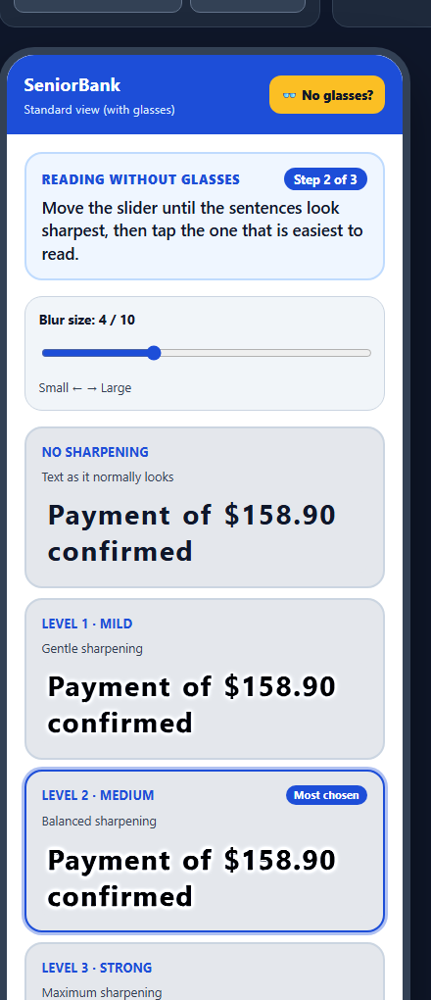
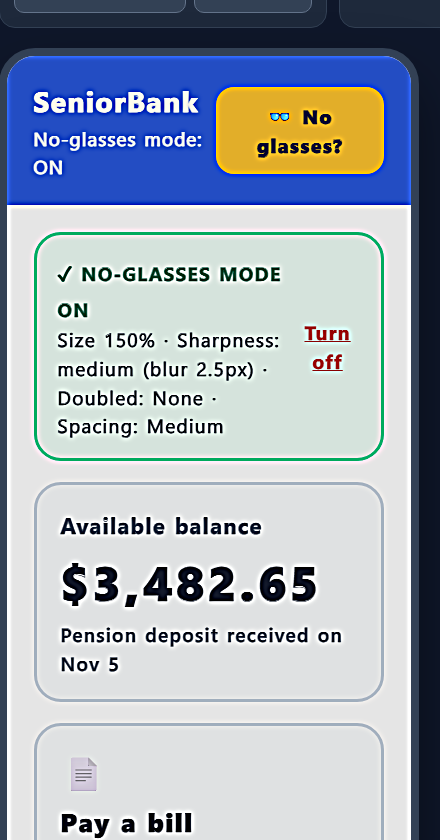
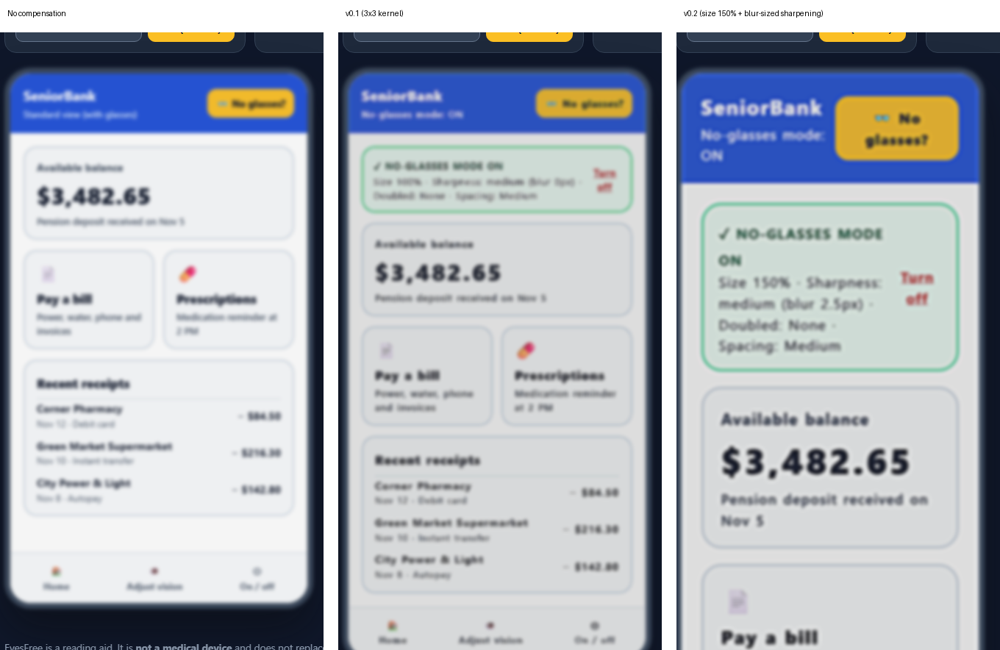
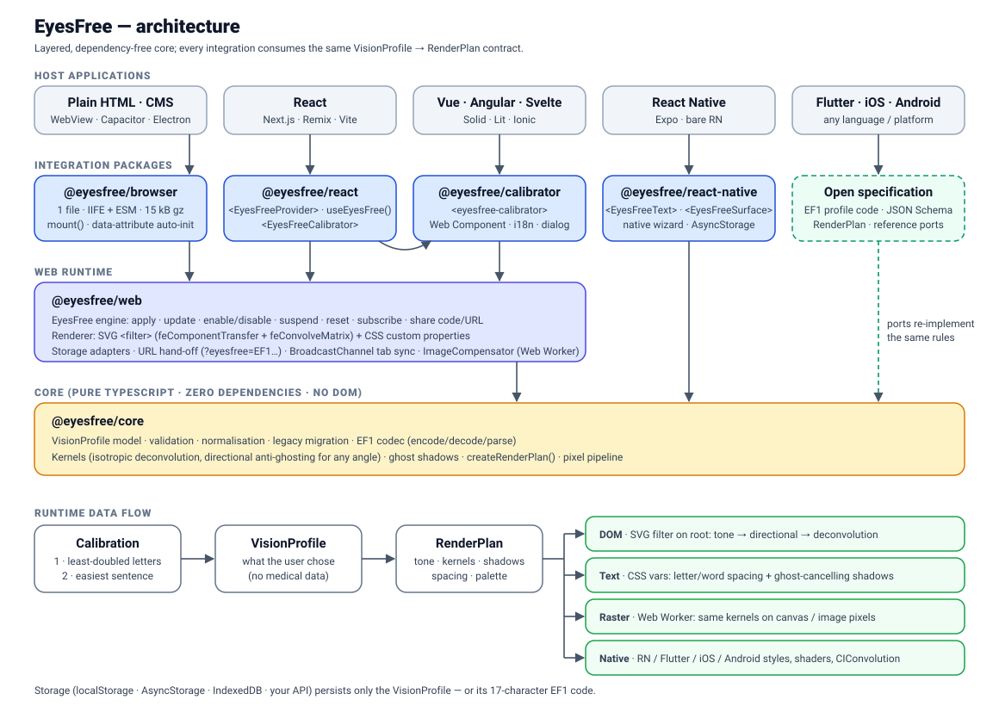

# EyesFree 👓

**Read the screen without your glasses.** EyesFree is an open-source accessibility toolkit that pre-compensates on-screen text for people with presbyopia, mild myopia or astigmatism who don't have their glasses at hand. It needs no prescription: a three-step visual calibration does the job.

[](LICENSE)


**▶ [Live demo](https://rbassoi.github.io/eyesfree/)**

<p align="center">
  
  
</p>

> ⚠️ **EyesFree is a reading aid, not a medical device.** It does not diagnose, treat or replace glasses, contact lenses or an eye exam. See [Scientific basis & limitations](docs/how-it-works.md#limitations).

---

## Why

Older adults lose or forget their glasses constantly, yet they still need to confirm a bank transfer, read a medication reminder or answer a message. Large-text modes help, but they break layouts and don't fix *blur* or *doubled letters*.

EyesFree takes a different route, **perceptual calibration**:

1. **Step 1 – text size.** The user taps the *smallest* sample they can read without effort. Magnification is the single most effective aid for presbyopia, so the whole app is enlarged and reflowed accordingly.
2. **Step 2 – blur size and sharpening (presbyopia / myopia).** The user moves a slider until the sample sentences look sharpest, then taps the easiest one. This sizes a large-radius inverse-blur filter to *their* blur (typically 5–20 screen pixels at reading distance) and slightly thickens strokes.
3. **Step 3 – doubled letters and spacing (astigmatism / crowding).** The user taps the card where `E A O` look *least doubled* and adjusts letter separation.
4. **Apply.** The choice is stored as a tiny profile and applied to the whole app: magnification, a sharpening SVG filter, ghost-cancelling text shadows, anti-crowding spacing and a low-glare surface that gives bright halos real luminance headroom.

No diopters, no medical data, no account: just "which one looks better?".

<p align="center"></p>
<p align="center"><sub>Simulated +2.00 D eye (σ = 2.5 px). Left: no compensation · middle: v0.1 3×3 kernel (no visible gain) · right: v0.2.</sub></p>

## Features

- 🧮 **Framework-agnostic core**: pure TypeScript with no DOM and zero dependencies. It runs in browsers, Node, Workers and React Native, and serves as a reference for other languages.
- 🌐 **Drop-in web engine**: one call applies compensation to any page, PWA, WebView, Electron, Capacitor or Ionic app.
- 🧩 **`<eyesfree-calibrator>` Web Component**: works with React, Vue, Angular, Svelte, Solid, Lit or plain HTML. Accessible (WAI-ARIA radio groups, keyboard navigation, 56 px targets) and localised (English, Português, Español, plus your own).
- ⚛️ **React** and 📱 **React Native / Expo** bindings.
- 🧵 **Web Worker image compensator** for canvas, charts, maps and rendered PDFs. It produces bit-identical output to the main-thread fallback.
- 🔗 **Portable profile code** (`EF1.hm211.100.150.250`): hand a profile from a native shell to a WebView, a QR code, a deep link or a support agent.
- 💾 **Pluggable storage**: localStorage, AsyncStorage, IndexedDB or your own backend API.
- 🔄 **Cross-tab sync**, **SSR-safe**, **CSP-friendly** (static worker and CSS files, nonce support).
- 📐 **Open spec** with a JSON Schema, so Flutter, Swift and Kotlin apps can interoperate.

## Quick start

### 1 · Any website: one script tag

```html
<script src="https://unpkg.com/@eyesfree/browser/dist/eyesfree.min.js"
        data-eyesfree-auto data-root="#app" data-locale="en"></script>

<button data-eyesfree-open>👓 No glasses?</button>
<button data-eyesfree-toggle>On / off</button>
```

That's it: the button opens the calibration dialog, the result is saved and re-applied on every visit.

### 2 · npm (any framework)

```bash
npm install @eyesfree/web @eyesfree/calibrator
```

```ts
import { createEyesFree } from '@eyesfree/web';
import { openCalibratorDialog } from '@eyesfree/calibrator';

const eyesfree = createEyesFree({ root: '#app' });   // restores the saved profile

glassesButton.onclick = () => openCalibratorDialog({ engine: eyesfree });
```

### 3 · React

```tsx
import { EyesFreeProvider, EyesFreeCalibrator, useEyesFree } from '@eyesfree/react';

<EyesFreeProvider options={{ root: '#root' }}>
  <App />
</EyesFreeProvider>;

function VisionSettings() {
  const { active, toggle } = useEyesFree();
  return (
    <>
      <button onClick={toggle}>{active ? 'Turn off' : 'Turn on'}</button>
      <EyesFreeCalibrator locale="en" onComplete={() => navigate('/')} />
    </>
  );
}
```

### 4 · React Native / Expo

```tsx
import AsyncStorage from '@react-native-async-storage/async-storage';
import { EyesFreeProvider, EyesFreeText, EyesFreeSurface, EyesFreeCalibrator } from '@eyesfree/react-native';

<EyesFreeProvider storage={AsyncStorage}>
  <EyesFreeSurface style={{ flex: 1 }}>
    <EyesFreeText style={{ fontSize: 18 }}>Balance: $3,482.65</EyesFreeText>
  </EyesFreeSurface>
</EyesFreeProvider>;
```

More recipes, covering Vue, Angular, Svelte, Next.js, Capacitor, Flutter, iOS, Android and backend sync, are in **[docs/integrations](docs/integrations/README.md)**.

## Packages

| Package | What it is | Use it when |
|---|---|---|
| [`@eyesfree/core`](packages/core) | Profile model, kernels, render plan, codec, pixel pipeline. Pure TS, no DOM. | You build an adapter, a port, or process images on a server or worker. |
| [`@eyesfree/web`](packages/web) | DOM engine, storage adapters, SVG filters, `ImageCompensator` (Web Worker). | Any web-based UI. |
| [`@eyesfree/calibrator`](packages/calibrator) | `<eyesfree-calibrator>` Web Component, dialog helper, i18n. | You want the ready-made wizard. |
| [`@eyesfree/react`](packages/react) | `EyesFreeProvider`, `useEyesFree`, `EyesFreeCalibrator`. | React web apps. |
| [`@eyesfree/react-native`](packages/react-native) | Provider, `EyesFreeText`, `EyesFreeSurface`, native wizard. | React Native / Expo. |
| [`@eyesfree/browser`](packages/browser) | Everything in one file (IIFE global `eyesfree` + ESM), static worker and CSS. | `<script>` tag, CMS, no build step. |

## Architecture

<p align="center"></p>

A user choice becomes a **`VisionProfile`** (what the user picked). `createRenderPlan()` turns it into a platform-neutral **`RenderPlan`** (tone mapping, kernels, shadows, spacing), and each adapter renders that plan in its own medium. Read the full design in **[docs/architecture.md](docs/architecture.md)**.

## Documentation

| | |
|---|---|
| 📐 [Architecture](docs/architecture.md) | Layers, data flow, rendering pipeline, design decisions |
| 🔬 [How it works](docs/how-it-works.md) | The optics and maths, tuning, limitations |
| 📄 [Profile & render-plan spec](docs/profile-spec.md) | Data contracts, EF1 code, JSON Schema, porting guide |
| 🔌 [Integrations](docs/integrations/README.md) | Step-by-step recipes for every platform |
| 📚 API reference | [core](docs/api/core.md) · [web](docs/api/web.md) · [calibrator](docs/api/calibrator.md) · [react](docs/api/react.md) · [react-native](docs/api/react-native.md) · [browser](docs/api/browser.md) |
| 🤝 [Contributing](CONTRIBUTING.md) | Dev setup, conventions, release process |

## Run it locally

```bash
git clone https://github.com/rbassoi/eyesfree.git
cd eyesfree
npm install
npm run demo        # builds everything and serves http://localhost:5173
npm test            # 53 tests: core maths, engine, worker, Web Component, React, React Native
```

In the demo, press **Simulate eye** to blur the phone the way an uncorrected eye would. Then calibrate and compare.

## Roadmap

- [ ] Dark-mode tuned presets (light-on-dark text)
- [ ] Optional distance estimation via front camera (opt-in, on-device)
- [ ] `@shopify/react-native-skia` GPU convolution component
- [ ] Published Flutter package (`eyesfree` on pub.dev) based on the [reference port](docs/integrations/flutter.md)
- [ ] User studies with optometry partners to refine presets ([help wanted](CONTRIBUTING.md))

## License and attribution

EyesFree is released under the **[Apache License 2.0](LICENSE)**. You may use it in commercial and non-commercial products, modify it and redistribute it. Redistributions **must keep the [NOTICE](NOTICE) file**, which credits the original project. Please also mention it in your documentation or "About" screen, for example:

> Optical compensation powered by [EyesFree](https://github.com/rbassoi/eyesfree).

Created by Ricardo and [contributors](AUTHORS).
