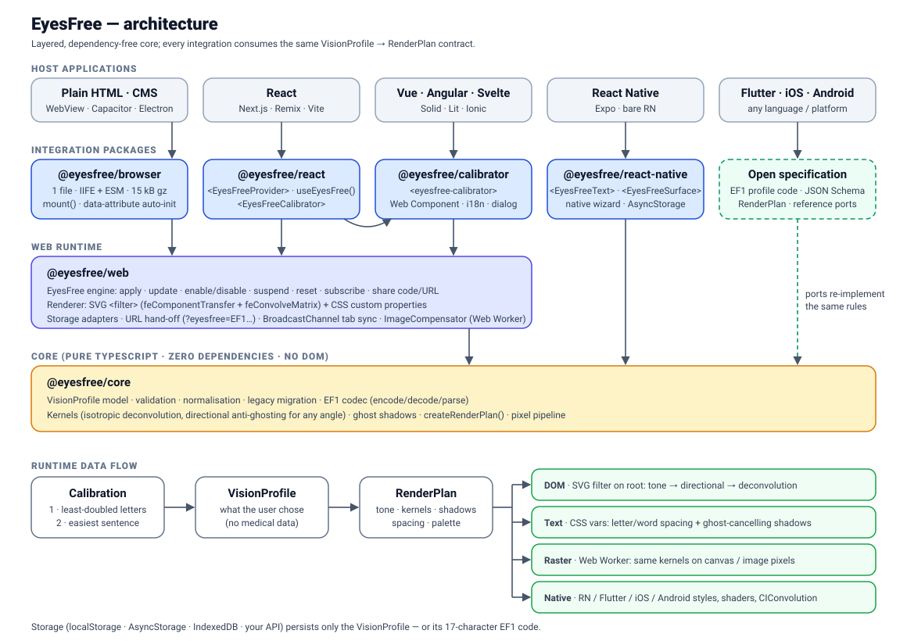
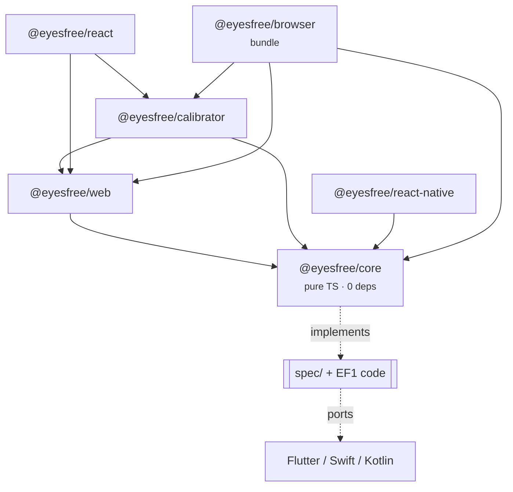
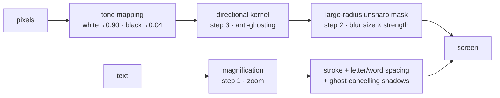
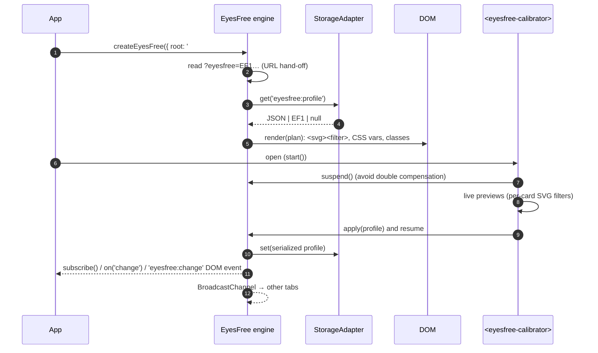
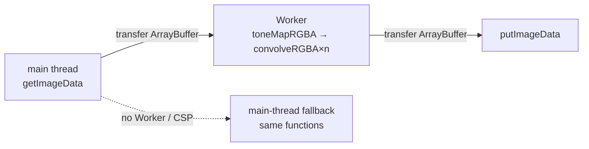

# Architecture

This document explains how EyesFree is organised, how data flows at runtime, and why the main design decisions were made. It is written for contributors and for teams integrating EyesFree into larger systems.



## 1. Goals that shape the design

| Goal | Consequence |
|---|---|
| **Run everywhere** (web, hybrid, React Native, Flutter, native) | A pure, dependency-free **core** owns every rule. Platform packages are thin adapters. |
| **Exchange profiles between platforms** | One small, versioned **`VisionProfile`** data contract plus a 17-character **EF1 code**. |
| **No duplicated maths** | Adapters never compute kernels themselves. They render a **`RenderPlan`** produced by the core. |
| **Zero-friction integration** | One `<script>` tag, a Web Component, React hooks, data attributes and DOM events. |
| **Privacy by design** | The profile stores *choices*, not medical data. No network calls. Storage is pluggable and optional. |
| **Never block the UI** | GPU-backed SVG filters for the DOM, and a **Web Worker** for raster content. |

## 2. Monorepo layout

```
eyesfree/
├─ packages/
│  ├─ core/            @eyesfree/core          pure TS: model, kernels, plan, codec, pixels
│  ├─ web/             @eyesfree/web           DOM engine, storage, SVG, CSS, Web Worker
│  ├─ calibrator/      @eyesfree/calibrator    <eyesfree-calibrator> + dialog + i18n
│  ├─ react/           @eyesfree/react         Provider, hooks, calibrator wrapper
│  ├─ react-native/    @eyesfree/react-native  store, Text/Surface components, wizard
│  └─ browser/         @eyesfree/browser       esbuild bundles (IIFE + ESM), worker.js, css
├─ apps/demo/          static demo (uses only the public browser bundle)
├─ spec/               JSON Schema of the profile (language-neutral contract)
├─ docs/               this documentation
└─ scripts/            dependency-free build / serve / clean helpers
```

npm workspaces link the packages. TypeScript project references (`tsc -b`) build them in dependency order, and Vitest tests them against their sources.

### Dependency graph



Rules:

- **`core` depends on nothing** and never touches `window`, `document` or storage.
- **`react-native` depends only on `core`**. It must never pull DOM code into a mobile bundle.
- Only `browser` is allowed to have side effects (the auto-mount from `<script data-eyesfree-auto>`), along with the explicit `@eyesfree/calibrator/define` entry.

## 3. Data contracts

### 3.1 `VisionProfile`: what the user chose

```ts
{
  version: 1,
  enabled: true,
  ghostAxis: 'none' | 'horizontal' | 'vertical' | 'diagonal45' | 'diagonal135' | 'outline',
  sharpness: 'none' | 'mild' | 'medium' | 'strong',
  crowding: 0 | 1 | 2 | 3,
  intensity: 1,              // 0.25 – 2, global strength multiplier
  surfaceCompensation: true, // luminance headroom for bright halos
  fontScale: 1,              // 1 – 2, hint for hosts that support it
  updatedAt?: '2026-11-13T10:00:00.000Z'
}
```

This is the **only** thing that is persisted or transmitted. It contains no prescription, no biometric data and no identifier. Full specification: [profile-spec.md](profile-spec.md).

### 3.2 `RenderPlan`: how to render it

```ts
{
  active: true,
  tone: { slope: 0.86, intercept: 0.04 } | null,
  kernels: [{ order: 3, matrix: [9 numbers] }, ...],   // applied in order
  shadows: [{ x, y, blur, color: [r, g, b, a] }, ...],
  textShadowCss: '-1.3px 0px 0px rgba(255,255,255,0.95), ...',
  letterSpacingEm: 0.065, wordSpacingEm: 0.08,
  fontWeightDelta: 200, fontScale: 1,
  surface: { background, surface, border, text } | null
}
```

`createRenderPlan(profile)` is deterministic and pure. All adapters must apply the pipeline in this order:



## 4. Runtime flow (web)



### Rendering on the DOM

When a plan is active, the engine:

1. Injects a stylesheet once (`#eyesfree-styles`), or skips that if you ship `eyesfree.css` for strict CSP.
2. Creates or updates `<filter id="eyesfree-filter">` inside a hidden `<svg>`. It contains `feComponentTransfer` (tone) followed by one `feConvolveMatrix` per kernel, with `color-interpolation-filters="sRGB"` so the result matches the worker exactly.
3. Sets CSS custom properties on the root (`--eyesfree-filter`, `--eyesfree-letter-spacing`, `--eyesfree-text-shadow`, …).
4. Adds the classes `eyesfree-active` and `eyesfree-scope-root` (or `eyesfree-scope-opt-in`, or `eyesfree-palette`).

Removing compensation (disable, reset, suspend, destroy) reverses all four steps, so nothing leaks.

### Filter scopes

| Scope | Where the SVG filter is applied | Trade-off |
|---|---|---|
| `root` (default) | the whole root element | Simplest. Images and icons are sharpened too. |
| `opt-in` | only `[data-eyesfree-text]` elements | Precise and cheaper on huge pages. Requires markup. |
| `none` | nowhere (spacing + shadows only) | For low-end devices or very large scrolling canvases. |

### Surface modes

The bright half of a deconvolution halo needs pixels *brighter than the background*. On pure white that is impossible, so EyesFree creates headroom in one of two ways:

| Mode | How | When |
|---|---|---|
| `tone` (default) | `feComponentTransfer` maps white→0.90 and black→0.04 inside the filter | No CSS changes at all |
| `palette` | Restyles the root and `[data-eyesfree-surface]` elements with a light-grey palette | When you prefer exact colours, or use `scope: 'opt-in'` |
| `both` | Both of the above | |

## 5. Web Worker: raster content

CSS filters only reach DOM rendering. Canvas charts, maps, PDF renderers and photos of documents go through `ImageCompensator`:



- The worker source is **generated from the core functions themselves** (`Function.prototype.toString`). Worker and main thread therefore run identical code, and a test asserts bit-identical output.
- Buffers are **transferred**, not copied, in both directions.
- The worker is spawned from a `blob:` URL by default. For CSP policies without `worker-src blob:`, point `workerUrl` at the shipped `eyesfree.worker.js`.
- If the worker fails at any point, pending jobs are re-run on the main thread, so callers never see a rejection caused by the environment.

## 6. Extension points

| You want to… | Use |
|---|---|
| Persist to your backend / sync across devices | Implement `StorageAdapter` (`get`, `set`, `remove`, sync or async) |
| Start from a profile set by a native shell or a support agent | `?eyesfree=EF1…` URL parameter, `engine.importProfile()`, RN `initialProfile` |
| React to changes outside your framework | `engine.subscribe()`, `engine.on('change')`, `document` event `eyesfree:change` |
| Style your own widgets (canvas, maps, charts) | `engine.getState().plan`, `ImageCompensator`, CSS variables |
| Exclude an element | `data-eyesfree-ignore` (spacing and shadows), or `scope: 'opt-in'` for the filter |
| Translate the wizard | `registerLocale('fr', {...})` or the `messages` property |
| Re-theme the wizard | CSS custom properties `--efc-accent`, `--efc-radius`, … |
| Port to another language | [profile-spec.md § Porting](profile-spec.md#porting-checklist) |

## 7. Design decisions

**Why SVG `feConvolveMatrix` instead of WebGL?** It is hardware-accelerated in every modern engine, applies to live, interactive DOM (text selection, inputs and accessibility tree stay intact), needs no canvas copy of the page and degrades gracefully.

**Why a perceptual calibration instead of asking for a prescription?** Most users don't know their prescription, and refraction varies with lighting, fatigue and distance. A forced choice ("which looks better?") is fast, language-light and is how optometrists refine prescriptions anyway.

**Why a Web Component for the wizard?** One implementation serves every framework, it is SSR-safe, and it renders into light DOM so SVG `url(#id)` references resolve in every browser. Shadow-DOM filter references are inconsistent across browsers.

**Why `suspend()`?** When the wizard lives *inside* the compensated root, its previews would otherwise be compensated twice and the user would calibrate against a distorted baseline.

**Why sRGB filter colour space?** It makes DOM and canvas/worker output identical and keeps the tuned kernels predictable across browsers.

## 8. Performance notes

- One filter per root, rebuilt only when the profile changes.
- `transition: filter` is enabled only when `prefers-reduced-motion: no-preference`.
- A 320×140 canvas takes about 60 ms in the worker on a laptop. Throughput scales linearly with pixel count, at about 9 multiply-adds per channel per kernel.
- Very large roots on low-end Android devices may scroll less smoothly with `scope: 'root'`. Prefer `opt-in` for long infinite lists.

## 9. Security & privacy

- No network access, telemetry, `eval` or `innerHTML` built from user input (the wizard escapes every message and attribute).
- The only dynamic code path is the worker built from library source. Use `workerUrl` under strict CSP.
- Profiles in URLs are validated strictly by `decodeProfile()`, so malformed codes are ignored.
- See [SECURITY.md](../SECURITY.md) for reporting vulnerabilities.
